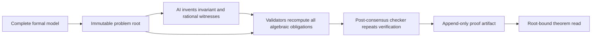
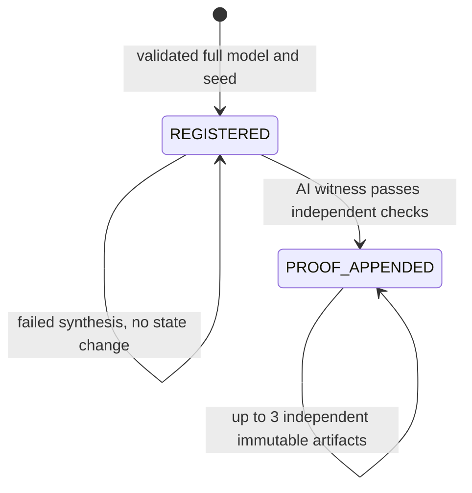

# AffineInvariantForge

Experimental GenLayer proof synthesis for small **unbounded-integer affine loops**. AI invents an inductive invariant and nonnegative rational implication witnesses. Validators independently check exact algebra against the complete immutable formal model before any proof is published.

StudioNet: [`0xDA879F8B628C7488360fFd91d32968f1c5D02B5f`](https://explorer-studio.genlayer.com/address/0xDA879F8B628C7488360fFd91d32968f1c5D02B5f). Counter and transfer proofs were generated and independently verified. The harder lockstep case **failed closed twice and published no proof**; it is not reported as passed. [Finalized evidence and failures](LIVE_PROOFS.md) · [Submission text](SUBMISSION.md).

Not an oracle, external service attestor, agent-alignment certificate, owner-controlled graph, or action permission. Mathematical models are the actual problem inputs, **not evidence that real software follows those models**. There are no funds, private documents, one-time consumers, graph heads or privileged finalizers.

## Problem and why GenLayer

A conventional contract can check a short proof but cannot conveniently search for a useful invariant. A private AI backend can invent plausible-looking invariants without proving their initial validity, inductiveness or safety consequence. This primitive places creative synthesis in a GenLayer nondeterministic call and makes publication contingent on independent exact verification of every proof obligation.

The nondeterministic result is consequential: its chosen invariant and multipliers become the immutable proof artifact. There is **no fallback that publishes an invariant computed solely from stored state**. Validators need not invent the same proof: many different proofs may be valid. They verify the actual candidate against the original problem, not a success label, confidence or explanation. [GenLayer's custom nondeterministic validation interface](https://docs.genlayer.com/developers/intelligent-contracts/features/non-determinism) separates this generation from deterministic storage writes.

## Architecture and boundary



The caller owns the formal specification; GenLayer owns synthesis, independent witness verification and artifact publication. There is no external-fact boundary and therefore no observer URLs stored but never fetched. Source-fetching boilerplate would not establish whether arbitrary software implements this formal model, so the contract does not pretend it can.

Distinct from prior submissions: this is proof-carrying **inductive reasoning**, not typed graph mutation; not a policy truth-table compiler; not finding one classifier counterexample; not text compaction; and not a flow, ranking, allocation or certificate lifecycle. Standard inductive invariants and linear-combination witnesses are established mathematics, not inventions claimed by this project. No global novelty, reviewer acceptance or production audit is claimed.

## Formal semantics

States `x` have 1–2 mathematical integer coordinates, without machine overflow. Initial constraints, guards and safety properties are conjunctions of rows `a·x <= b`. Each enabled step performs the **simultaneous** assignment `x' = Mx + c`. Safety must hold initially, during execution and on loop exit. Termination is not asserted.

The caller supplies a seed satisfying every initial row. This prevents an empty initial polyhedron from vacuously satisfying all obligations. It is checked, not trusted. Up to 4 initial rows, 3 guard rows, 2 safety rows and 3 invented invariant rows keep verification bounded. Limits on coefficients, dimensions, witness weights, scales and serialized size are explicit in the contract.

For every claimed implication `S => t`, the proof gives nonnegative integer weights `w_i` and a positive integer scale `q`. The checker requires:

`sum(w_i * S_i.a) == q * t.a` in **every coordinate**, and `sum(w_i * S_i.b) <= q * t.b`.

These identities imply the target inequality for every real state satisfying the sources, hence also for integer states. Integer arithmetic is exact; no floats, numerical tolerances, sampled-state approximation, arbitrary code execution, `eval`, SMT service, or model confidence is used.

Three groups of witnesses are mandatory:

1. **Initialization:** initial rows imply every invariant row.
2. **Preservation:** invariant rows plus guards imply each substituted invariant row `(aM)·x <= b-a·c`.
3. **Safety:** invariant rows imply every requested safety row, without assuming the loop guard.

Missing obligations, negative multipliers, zero scales, wrong source ordering or one incorrect coefficient prevent publication. Generation has at most two AI calls: an invalid first witness receives the exact checker failure for one repair attempt. No deterministic answer or unchecked fallback is installed. This witness format is sufficient, not complete: some valid integer properties require other invariant shapes or reasoning. Failure to synthesize a proof is **not a counterexample, unsafe verdict, or proof of impossibility**.

## State and API



`register(nonce, model_json)` creates an immutable creator/contract/nonce-bound problem (max 32 per creator). Identical mathematical models may be registered explicitly in different namespaces; roots make this visible rather than silently replacing a problem.

JSON string arguments optionally accept a `json:` prefix to keep the native CLI from coercing a JSON object into calldata dictionary type. The prefix is removed before strict parsing; roots bind the parsed model, not its whitespace or transport spelling. SDK callers can pass an ordinary JSON string.

`synthesize(problem_id, expected_attempt)` is **permissionless**, not owner-finalized. It uses an optimistic attempt index and appends at most three successful artifacts per problem. No failure consumes an attempt index. Existing artifacts are never changed. The binding includes contract, policy version, problem ID/root, model root, requester and attempt index.

`get_problem`, `get_proof`, `attempt_count` expose immutable records and committed count. `audit(problem_id, proof_json)` independently checks supplied algebra without publishing it. `theorem(proof_id, expected_problem_root, expected_proof_root)` is repeatable, read-only and refuses wrong roots or problem substitutions. It grants no execution authority and is not a consumable credential.

Errors or validator disagreement publish no artifact. They are not falsely recorded as successful `CONFLICTED` business states. No locks or escrow can strand funds. A willing third party can retry synthesis after inspecting an uncertain transaction's receipt; there is no administrator veto.

## Examples

`examples/counter.json`: start at `x=0`; while `x<=9`, increment `x`. Prove `0<=x<=10` for all reachable states. A useful invariant contains both requested inequalities. A generated witness must establish them; the contract does not hardcode this solution.

`examples/transfer.json`: start at `(x,y)=(10,0)`; while `x>=1`, simultaneously assign `(x-1,y+1)`. Prove `x+y<=10` and `x>=0`. Preservation uses a relational two-variable invariant and a guard-dependent lower bound. These are fictional mathematical fixtures, not external inventory or service-delivery evidence.

`examples/lockstep.json`: start at `(0,0)`; while `x<=9`, increment both coordinates. Prove `y<=10`. Merely copying the requested safety row is **not inductive**: `(x,y)=(0,10)` satisfies it and the guard but steps to `(1,11)`. A proof must invent additional constraints, for example `y-x<=0` and `x<=10`, then prove those constraints too. No generated solution is supplied to the live model.

## Install and test

```powershell
python -m venv .venv
.venv\Scripts\pip install -r requirements-dev.txt
npm ci --ignore-scripts
.venv\Scripts\genvm-lint check contracts/AffineInvariantForge.py
.venv\Scripts\python -m pytest tests -q
npm run test:unit
npm run test:sdk
```

38 Python tests and 5 independent JavaScript tests; 7 SDK calldata roundtrips. Coverage includes all three proof obligations, rational scaling, initial-state guard mistakes, simultaneous matrix substitution, invented relational strengthening, bounds/schema/duplicate keys, proof and problem substitution, stale attempts, immutable artifacts, bounded checker-guided AI repair, failed synthesis not reserving state, actual validator callback verification, and post-consensus forgery. Exhaustive small implication witnesses are also checked for bounded integer counterexamples by separate Python and BigInt JavaScript implementations. The algebraic argument—not enumeration—establishes the unbounded theorem.

Direct-mode tests run only the leader. Callback unit tests execute the validator explicitly; neither substitutes for actual network consensus. The narrow Windows cleanup fixture only defers gltest's known open-temporary-file unlink; contract exceptions are not masked. Live results belong in [LIVE_PROOFS.md](LIVE_PROOFS.md), not assumed from local success.

## Deploy and verify

```powershell
npm install -g genlayer@0.39.2
genlayer network set studionet
genlayer account create --name forge-test
genlayer account use forge-test
genlayer account unlock
genlayer deploy --contract contracts/AffineInvariantForge.py
genlayer schema CONTRACT_ADDRESS
```

StudioNet is the gasless testing environment. Use a dedicated encrypted test keystore and native vault signing; never export a private key, paste passwords into chat, fund this demo, or commit credentials. No global account/network mutation is needed by the provided wrapper: `FORGE_TEST_ACCOUNT` selects the existing native account process-locally; `FORGE_CLI_PATH` optionally points at the installed CLI entrypoint.

`node --dns-result-order=ipv4first scripts/complete-proofs.mjs` runs the documented serial demo and saves a public receipt ledger before/after each broadcast. It resumes known hashes read-only and halts on unknown outcomes; never blindly rerun a timed-out send. Native CLI arguments are passed without shell interpolation. Raw validator/provider configuration is suppressed.

`node scripts/check.mjs source CONTRACT_ADDRESS` compares actual deployed source to the local contract. `node scripts/check.mjs state CONTRACT_ADDRESS PROBLEM_ID` recomputes model/proof roots, checks witnesses in independent BigInt arithmetic and reads root-bound theorems. `node scripts/verify-live.mjs` rechecks the entire existing ledger without signing or sending. Finalization alone is insufficient: require execution `SUCCESS`, consensus `MAJORITY_AGREE`, matching source and actual state. Expected `ERROR` transactions are rejection tests, not successful proof syntheses.

The tested Studio endpoint rejected long RLP-wrapped SDK `gen_call` reads with an RLP decoding error. The verifier uses SDK-encoded **raw calldata** in explicit read-mode `gen_call` requests instead; full-proof audits then work without changing the deployed contract. Its RPC allowlist refuses writes, and transport failures never count as expected contract rejections.

Explorer links use `https://explorer-studio.genlayer.com/address/ADDRESS` and `/tx/HASH`. See [submission text](SUBMISSION.md), [security boundaries](SECURITY.md), and [architecture](docs/architecture.md).
